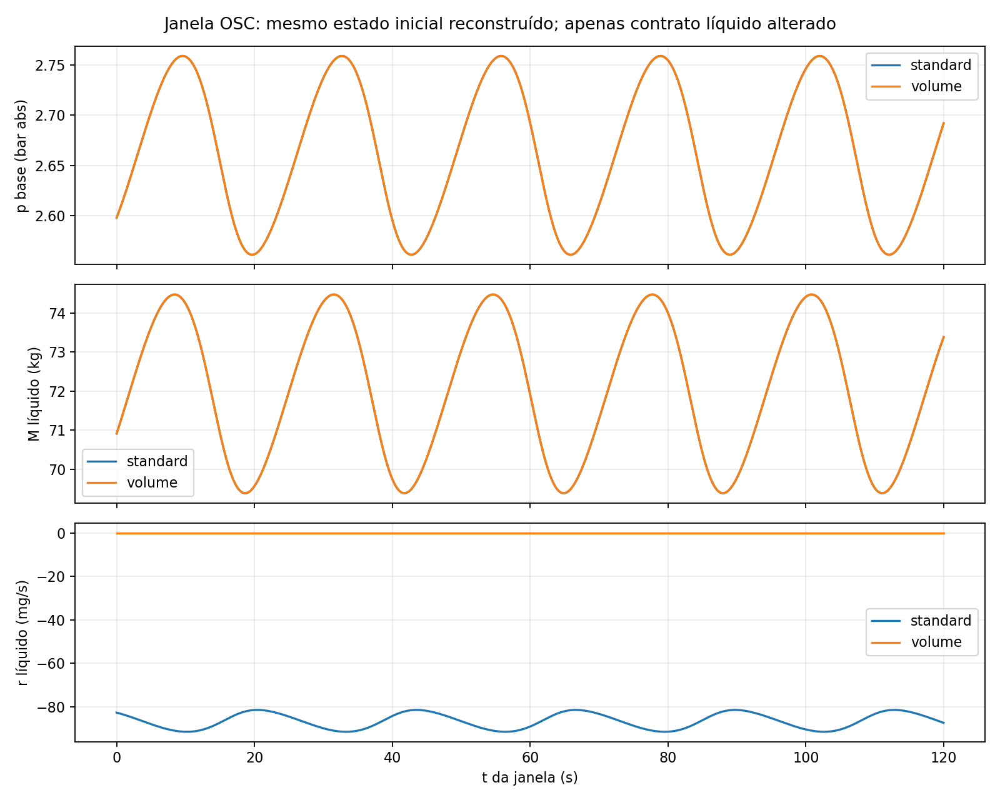

# PRIMS-F: auditoria P0 dos contornos — 19/11/2026

**Conclusão: qualificação parcial, com defeitos demonstrados em controles.**
Não foi demonstrado que os contornos causem SS1/SS3 ou a amplitude OSC.
Foram implementados instrumentos, testes e protótipos isolados; `scr/`,
defaults, física, `main` e remoto foram preservados.

Branch `audit/boundary-contract-20261119`, base `2c3e3af`.
Produção: mesmo binário da qualificação a179e51, SHA256
`02ce51462ec3c954cec9364b17444b7279be72ec150f87e307f1b5fc8dd0a4c3`.
gfortran13.3.0, Fortran2018/O2/OpenMP, BLAS/LAPACK3.12.0.
Protocolo anterior aos testes: commit08cd4a5. AGENTS.md não foi encontrado
no repositório/ancestrais; skill e handoff foram lidos.

| Problema → fonte/equação | Causa/operador demonstrado | Teste → evidência | Status |
|---|---|---|---|
| Alimentação líquida → sistema §4/Eq24 | `boundary_flux` fixa massa; com EOS compressível, rho_l0*Ql0 não fixa Ql0 | Fortran/estacionário: erro Ql4,9674e-5; protótipo `volume`: zero | **FAIL** padrão / **PASS** protótipo |
| Alimentação gasosa → Eq25 | Fg imposto diretamente na face | Fluxo efetivamente aceito: erro zero | **PASS** executado |
| Pressão → Eq26 | F=F(Ubc), pB=EOS(Ubc), sem média celular | Erro máximo1,80e-10 Pa | **PASS** executado |
| Face interna → Eqs27–29 | `face_pair` usa mesmo fluxo por fase e P* comum | Cancelamento exato; seis balanços aprovados | **PASS** controles/janelas |
| Partição artificial | MATCHED ativa por seção horizontal mesmo com modelo/ângulo idênticos | Divisão2→4 altera R_momento5,97098e-6; bypass estrito zera diferença | **FAIL** padrão / **PASS** protótipo |
| Hidrostática → Munkejord §5 | Pressão central usada na face de entrada sem compatibilidade com fonte | R_momento0,03964778; face analítica deixa apenas quadratura~4,2e-12 | **FAIL** controle |
| Características → Baudin §2.7; dissertação4.28–30 | FV1 atual não implementa Wbc; extrapola p na entrada, alpha/U3 na saída | 983 estados exatos/variante: contagem e posto2/1; reversão mostra1/2 | **PASS** observado; reversão **NOT_VERIFIED** |
| Jacobiano completo | `assemble` reconstrói Ubc a cada perturbação; D(Uold) congelado também no residual | Estêncil independente/curvas h/replays: erro mínimo~3e-12…1,04e-11 | **PASS** estados/ramos testados |

No FV1 ativo, faces externas chamam `boundary_flux` diretamente e faces
internas usam células físicas. Não se presumiu inadequação dos halos nem se
identificou cadeia Ughost(Uinterno) omitida no Jacobiano desses contornos.

**Janela OSC nova:** entrada comum reconstruída do frame3000 s do histórico
69813ee, sem alegar restart exato. N51+51;120 s;982 passos;zero recusas;
dt efetivo0,001…0,125 s. Observadores v1/v2 reproduzem monitor/campos/ledger
da cópia sem instrumentação byte a byte. Fluxos e pesos backward Euler são
os efetivamente aceitos.

| Métrica | Padrão | Protótipo volumétrico |
|---|---:|---:|
| máximo erro relativo de imposição Ql | 7,73752e-5 | 0 |
| erro integrado de alimentação líquida (kg) | -0,01038145 | 0 |
| erro integrado/Ml inicial | -1,46395e-4 | 0 |
| erro integrado/massa prescrita | -7,31595e-5 | 0 |
| pior conservação/M0, seis balanços | 1,24903e-8 | 1,27024e-8 |
| semi-excursão da pressão (Pa) | 9922,029 | 9920,978 |
| pressão média da base (Pa) | 266108,743 | 266109,299 |
| espaçamento médio dos picos amostrados (s) | 23,125 | 23,125 |

Há quatro intervalos completos entre picos. A semi-excursão muda−0,01059%;
isso não qualifica dez ciclos, convergência ou amplitude experimental.
Balanço fechado com fluxo efetivo e respeito à vazão prescrita são separados.
Limiares prévios: imposição1e-10; pressão max(1e-7 Pa,1e-12 Pt);
seis balanços/M0<=1e-6; derivadas1e-5; partição1e-12.
Denominador zero produz normalização indefinida e erro absoluto reportado.

**Replays:** quatro snapshots, três variantes,18 lambdas/snapshot.
SS1 histórico: FACE53/status3012, jg*≈−6,055e-9 m/s na proposta completa;
SS3: CELL69/status1017. Contornos externos têm status0 em todas as propostas,
também no protótipo volumétrico. São tentativas Newton recusadas, não
contrafluxo físico observado. Isso localiza a recusa, sem excluir influência
anterior dos contornos nem provar ausência global de raiz.

Estacionário não nulo FV: residual9,095e-13. Uniforme parado/G=0:8,33e-17.
Seis controles de enchimento/drenagem/fase quase ausente completam2 s,
sem recusas; pior balanço/M0=1,313e-8. Fase exatamente ausente tem fluxo
de contorno finito e status explícito1031=CELL+31 na derivada tridimensional.
Acústica com fontes foi testada no sistema tangente congelado; pressão fixa
reflete com inversão, sem usar absorção como alvo. NSCBC/Riemann não linear
permanece **NOT_VERIFIED**.

**Testes:** release/debug;15 programas Fortran/3674 asserções;103 testes Python
da CI;21 verificações CLI de configuração e5 de telemetria;mais6 testes dos
protótipos release/debug: **PASS**. As regressões diagnósticas do contrato e
partição falham no padrão e passam no respectivo protótipo, conforme esperado.

**Correções propostas:** explicitar a base volumétrica/mássica, reconciliando
overrides e estacionário; bypass de MATCHED só na face de modelo/ângulo
idênticos; compatibilidade de fronteira com fontes/posição da face, começando
pela hidrostática. Esta última exige formulação não linear e regressões.
Não foram aplicados clipping, absorção, não retorno ou Chexal inclinado.

SS1/SS3: **BLOCKED** para qualificação de regime. OSC: conservação curta
**PASS**; convergência/validação física **NOT_VERIFIED** nesta auditoria.
O FAIL histórico de amplitude com refinamento permanece identificado no
relatório anterior. Backflow de reservatório e evolução monofásica reduzida
continuam pendentes.

Fontes conferidas: sistema/p5/Eqs24–29; dissertação/página PDF98,
**impressa96**/Eqs4.28–30;
[Baudin/§2.7/preprint p9](https://www.ljll.fr/ERTint/pdf/bct05.pdf);
[Munkejord/§5/preprint pp5–7](https://www.pvv.org/~stm/dring/cbccomm.pdf).
A adaptação4→3 foi limitada à projeção diferencial com fontes, sem supor
R(U)^−1 U como invariantes globais. Baliño2010/Eqs78–79 e Tabela3 confirmam
condições padrão e pressão absoluta (bar a).

[Métodos, balanços em kg, bibliografia, comandos e limitações](BOUNDARY_CONTRACT_DETAILS_20261119.md).
[Instrumentos/protocolo](../validation/diagnostics/boundary_contract_20261119/PROTOCOL.md).
Dados completos: `/home/leonardoab/Documentos/PRIMS-F-boundary-results-20261119`,
com manifestos por build/execução, R/J/candidatos NPZ, séries aceitas,
campos e checkpoints atômicos. Nenhum PDF/executável no Git.

