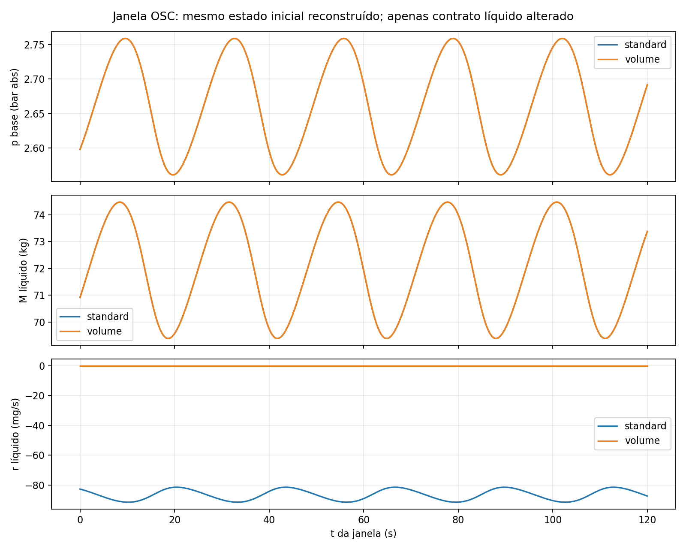
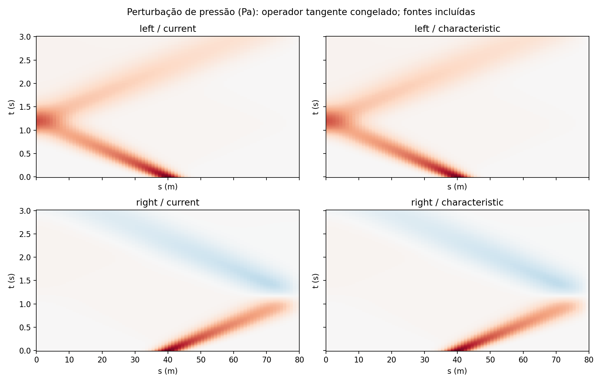

# Auditoria P0 dos contornos — 19/11/2026

**Conclusão:** contornos parcialmente qualificados. Há diferenças demonstradas
entre o contrato volumétrico e a entrada implementada, falta de preservação
hidrostática num controle e dependência de uma partição artificial no momento.
Não foi demonstrado que esses resultados causem SS1/SS3 ou a amplitude OSC.
As alternativas permanecem em cópias geradas fora de `scr/`; solver, física,
defaults, `main` e remoto foram preservados.

**Versão e evidência.** Branch `audit/boundary-contract-20261119`, continuação de
`2c3e3af8c99d490ffc1dcbf9357da6c0d59d633d`. Não havia AGENTS.md no repositório
nem nos seus ancestrais. Consultada a skill `rotodinamica-fem-fortran`.
Protocolo anterior aos testes: commit `08cd4a5`,
[`PROTOCOL.md`](../validation/diagnostics/boundary_contract_20261119/PROTOCOL.md).
Produção: gfortran 13.3.0, Fortran 2018, `-O2`, OpenMP; BLAS/LAPACK
3.12.0-3build1.1. Binário de produção SHA256
`02ce51462ec3c954cec9364b17444b7279be72ec150f87e307f1b5fc8dd0a4c3`.
É o mesmo binário da qualificação a179e51; 69813ee continua identificado como
operador histórico. Nenhum dado novo é atribuído a 05ad799 ou 490936a.

Resultados completos, entradas e fontes geradas:
`/home/leonardoab/Documentos/PRIMS-F-boundary-results-20261119`.
Cada build tem manifesto com comando, fontes e hashes; cada execução tem
`audit_manifest.json`. `evidence_manifest.json` registra dependências, hashes
e o diff vazio dos fontes de produção. PDFs e executáveis ficam fora do Git.

**Fonte → rotina → teste → resultado**

| Requisito/fonte | Operador efetivamente executado | Teste/evidência | Status |
|---|---|---|---|
| sistema §4/Eq24: `jl=Ql0/A` | `boundary_flux`, entrada: `jl=cfg%mul/rhol`; main usa `mul=rho_l0*jl0`, salvo override explícito | Regressão Fortran `contract`; estacionário não nulo; registro por passo OSC | **FAIL** contrato Q com EOS compressível; **PASS** no protótipo `volume` |
| Eq25: `rhog*jg=mdotg0/A` | Componentes de F retornadas diretamente como `cfg%mul,cfg%mug` | Fluxo efetivo aceito vs alvo, não apenas inventário | **PASS** gás nos casos executados |
| Eq26: `p=Pt` | Saída mantém alpha interior e U3, reconstrói massas com EOS em Pt e recupera velocidades | pB=EOS(Ubc), estado cujo fluxo físico entra no residual | **PASS**, máximo erro 1,80e-10 Pa nas janelas |
| Eqs27–29: face interna | `face_pair`: mesmo Gl/Gg em FM/FP; P* comum; dois traços de momento | Ledgers aceitos, seis balanços; resíduos adjacentes com sinais opostos | **PASS** cancelamento por fase nos controles/janelas |
| Dissertação §4.3.1/Eqs4.28–30 | Não há Wbc ou substituição característica no caminho FV1 atual | Mapa de chamadas + protótipo tangente com base congelada | Correspondência literal **FAIL**; inadequação do fluxo atual não decorre só disso |
| Baudin §2.7/Eqs2.34–37 | Entrada atual impõe diretamente componentes de fluxo; saída atual extrapola alpha/U3 | Alvos de face, posto sobre modos entrantes, Jacobiano completo | **PASS** algébrico observado; não é implementação do esquema de relaxação do artigo |
| Munkejord §5/Eqs11–23, fontes | Fontes implícitas de gravidade/atrito em `point_state`; nenhuma ODE característica própria na fronteira | Hidrostática independente; ondas no operador tangente com dS/dU real | Hidrostática **FAIL**; adaptação não linear **NOT_VERIFIED** |
| Invariância à partição | MATCHED pode ativar em theta=0 conforme N_pipe mesmo com fechamento idêntico | N_pipe=2 vs4; mesmos seis U, theta, larguras e fechamento2 | **FAIL** padrão; **PASS** protótipo `partition` |
| Derivada completa da fronteira | `assemble` perturba U interior e chama novamente `boundary_flux` | Estêncil independente de quarta ordem e curvas h=1e-3…1e-7; replays completos | **PASS** nos estados/mesmos ramos examinados |

`apply_ghost_cells` copia halos após aceitação e na inicialização. O residual
FV1 usa apenas as células físicas, `face_pair` nas faces internas e
`boundary_flux` nas duas extremidades. `apply_boundary_conditions` é auxiliar;
não é chamado pelo transiente atual. MUSCL não é executado nesse caminho.
Portanto, não foi atribuída uma falha às células fantasma como recurso.

**Equações e convenções conferidas**

`sistema_oleoduto_riser.pdf`, página5, Eqs24–29, distingue explicitamente Ql0
volumétrico e mdotg0 mássico. Com a EOS implementada,
`rho_l(p)=rho_l0+(p-p_l0)/Cl²`, impor `rho_l0*Ql0` não mantém Ql0 exatamente.
O observador calcula `rm_l=A*fhat_l-rho_l(pB,in)*Ql0`, além do alvo mássico
legado; `rm_g=A*fhat_g-mdotg0`. Fluxos são kg/(m² s); A é aplicado uma vez.
`rp=EOS(Ubc,out)-Pt`, sem média com o centro de célula.

No PDF local da dissertação, as Eqs4.28–30 estão na página PDF98, **impressa96**;
a impressa98 trata da malha. A projeção W=R^-1 U ali descrita não define por si
só Wbc a partir de Ql0, mdotg0 e Pt. Para R variável,
`d(R^-1 U)=R^-1 dU+d(R^-1)U`; não se assumiram invariantes globais.

[Baudin, Coquel e Tran (2005), DOI10.1137/030601624](https://doi.org/10.1137/030601624),
§2.7, [preprint primário, p9](https://www.ljll.fr/ERTint/pdf/bct05.pdf):
as Eqs2.34 impõem condições no fluxo numérico, a Eq2.35 usa projeção no estado
interno, a Eq2.36 fixa pressão e as Eqs2.37 extrapolam outras variáveis no
modelo de relaxação. Não foram importados seu sistema de cinco incógnitas,
coeficientes de relaxação ou condição adicional de não retorno.

[Munkejord (2006), DOI10.1002/cnm.849](https://doi.org/10.1002/cnm.849),
[preprint §5, pp5–7](https://www.pvv.org/~stm/dring/cbccomm.pdf): projeção
diferencial, separação das amplitudes entrantes e retenção das fontes.
A adaptação matemática possível ao PRIMS-F usa **três** modos do Jacobiano
real e diagonalizável: `U_t+R Lin+R Lout=S`, com amplitudes espaciais projetadas.
Para H(U)=h constante, `H_U R_in Lin=H_U S-H_U R_out Lout`.
Isso requer posto e número de dados compatíveis; não transfere o fechamento
de quatro equações, autovetores ou ganhos PID daquele artigo.
O protótipo acústico testa apenas incrementos numa base congelada, com a
fonte linearizada real. Não implementa NSCBC não linear nem Riemann exato.
O PDF foi acessado pelo espelho do autor `.pvv.org`; o download local falhou,
mas a leitura das equações pelo navegador funcionou. SIAM/CiteSeer falharam;
o preprint Baudin foi obtido no LJLL. Hashes locais estão em `sources.json`.

[Baliño et al.2010](https://doi.org/10.1016/j.ijmultiphaseflow.2010.04.003), p649/Eqs78–79: gás em condições padrão vira massa por
`rho_std=Pstd/(Rg*Tstd)`; `jl0=Ql0/A`. A Tabela3/p653 informa **bar a**;
a legenda nominal de1 bar g não deve ser somada novamente aos 2,06 bar a
do caso13. O código usa pressão absoluta. Com os dados adotados,
rho_std=1,20403 kg/m³; a EOS barotrópica Cg=343 dá0,86104 kg/m³ a Pstd.
Isso altera a equivalência volumétrica local, sem alterar a massa prescrita.
Não se mudou EOS, temperatura, propriedade ou vazão para ajustar amplitude.

**Métricas novas**

Limiares fixados no protocolo: imposição relativa1e-10; pressão
max(1e-7 Pa,1e-12 Pt); seis erros/M0<=1e-6; derivada escalada1e-5;
partição1e-12. Vazão/inventário de referência zero produz normalização
indefinida e erro absoluto reportado, sem piso de massa.

Estacionário não nulo independente, quatro volumes, fechamento2: residual
máximo escalado9,095e-13 nas duas variantes; diferença de fluxo líquido/gás
entre extremidades <=6,51e-19 nd, salvo arredondamento líquido5,55e-17.
Erro Ql relativo padrão4,9674e-5; `volume` zero. O estacionário uniforme
bifásico parado, theta=0 e G=0 (controle declarado), dá residual8,33e-17.

Hidrostática: líquido parado, theta=0,7, EOS analítica e Pt fixo. Para uma célula
de comprimento12,546 m, a face inferior hidrostática requer291843,44 Pa;
o fluxo atual usa252312,62 Pa, pressão do centro. Residual de momento
0,03964778 nd com dt_nd=0,001; usando a face hidrostática de referência,
resta erro de quadratura da fonte ~4,2e-12. Três comprimentos foram testados.
É um controle discriminante da extrapolação/fonte, não uma mudança de pressão
aplicada ao solver. A evolução/Jacobiano tridimensional de fase exatamente
ausente retorna1031=CELL+31 explicitamente; não foi fabricado um espectro.

Partição: deslocar a divisão horizontal2→4 muda R_momento em5,97098e-6 nd;
massas diferem apenas por arredondamento e o fluxo comum cancela exatamente.
O protótipo desativa MATCHED **somente** quando closureL=closureR e thetaL=thetaR:
erro de partição zero. No controle inclinado uniforme sem interface artificial
ativa, o padrão já apresenta diferença zero.

Enchimento/drenagem: seis execuções de2 s, 20 volumes, geometria/fechamento2
declarados nos decks, tol_res=1e-10. Todas completam, sem rejeições. No controle
denominado filling, Ml inicialmente cresce6,488e-4 kg e atinge +0,2564 kg
em0,566 s; depois diminui. Não se classificou seu nome como regime observado.
Gás é acumulado nos controles; o caso near_absent_gas inicia com alpha=1e-8,
sem piso. Maior erro/M0 dos seis balanços:1,313e-8.

OSC: frame3000 s da campanha histórica69813ee, reconstruído das primitivas SI
impressas em binário64, constitui **a mesma entrada** para todas as variantes;
não é restart exato do histórico. N=51+51, dt_max=0,125 s, 120 s novos,
982 passos aceitos, zero recusas, dt efetivo0,001…0,125 s. `plain`, observador
v1 e v2 produzem monitor/campos/ledger idênticos. A v2 grava U interior/Ubc
exatos por passo e checkpoint conservativo atômico; não salva todo o estado
do controlador para prometer reinício temporal byte a byte.

| Métrica na janela | Padrão | Protótipo volume |
|---|---:|---:|
| max erro relativo Ql | 7,73752e-5 | 0 |
| erro integrado líquido vs contrato Q (kg) | -0,01038145 | 0 |
| erro integrado/Ml inicial | -1,46395e-4 | 0 |
| erro integrado/massa prescrita | -7,31595e-5 | 0 |
| erro de imposição gás (kg/s e kg) | 0 | 0 |
| pressão média de base (Pa, trapézio diagnóstico) | 266108,743 | 266109,299 |
| semi-excursão, (max−min)/2 (Pa) | 9922,029 | 9920,978 |
| espaçamento médio dos picos amostrados (s) | 23,125 | 23,125 |
| intervalos completos entre picos | 4 | 4 |
| pior dos seis erros de conservação/M0 | 1,24903e-8 | 1,27024e-8 |

A semi-excursão muda−0,01059%; o espaçamento tem resolução limitada pela
amostragem temporal. Balanço fechado com o fluxo efetivo **não** prova a
imposição de Ql. Os fluxos/integrais da tabela usam o mesmo dt backward Euler
aceito; resíduos de Newton não são subtraídos do erro.

| Balanço | erro absoluto padrão (kg) | /M0 padrão | erro absoluto volume (kg) | /M0 volume |
|---|---:|---:|---:|---:|
| líquido/global | 2,6432e-12 | 3,7274e-14 | 3,2685e-12 | 4,6091e-14 |
| líquido/oleoduto | 1,2895e-9 | 2,3150e-11 | 1,2754e-9 | 2,2897e-11 |
| líquido/riser | 1,2921e-9 | 8,4937e-11 | 1,2786e-9 | 8,4047e-11 |
| gás/global | 3,1564e-12 | 1,8103e-11 | 3,1542e-12 | 1,8091e-11 |
| gás/oleoduto | 2,9162e-10 | 1,9344e-9 | 2,9663e-10 | 1,9677e-9 |
| gás/riser | 2,9478e-10 | 1,2490e-8 | 2,9978e-10 | 1,2702e-8 |

Erros assinados, normalização por massa processada, defeitos por passo e
inventários estão em `analysis.json`. Fluxos da junção cancelam exatamente.

Características: cada variante v2 tem983 estados (inicial+982 aceitos), em
ambas as extremidades, avaliados no U interior e Ubc. Espectros reais,
duas entrantes na entrada/uma na saída e postos2/1, tanto para restrições
mássicas quanto volumétricas. Menor |lambda| observado ~1,309 m/s.
Os controles negativos de fechamento2/estratificado mostram1/2 entrantes;
a função de fronteira pode retornar sucesso sem certificar a configuração
física reversa. Na reversão do topo faltariam dados do fluido entrante do
reservatório; o estudo não inventa composição/velocidade nem proíbe retorno.

Acústica, sistema tangente congelado com dS/dU, 80 volumes/1 m, dt=0,002 s:
pulsos100 Pa à esquerda/direita. Picos modais refletidos31,10/31,21 Pa no
operador atual e30,60/30,60 Pa na projeção característica incremental.
Fonte e dissipação atenuam o pulso; esses valores não são coeficientes físicos
de reflexão. A inversão de pressão na saída fixa é esperada, não meta de
absorção perfeita. O experimento tangente não qualifica reflexão não linear,
backflow ou influência global sobre OSC.

**Replays e causalidade**

Quatro snapshots históricos, nas variantes standard/volume/partition;
Uold, estado linearizado, R, J e escalas preservados em `replay_arrays/*.npz`.
`replays.json` contém os18 lambdas, candidatos conservativos, fluxos de
contorno, primitivas, autovalores, traços internos e localização da recusa.
U e R são armazenados na base adimensional indicada por metadata; para SI,
use diag(omega_rho,omega_rho,omega_rho*omega_u), e transforme J por
D*J*D^(-1). As propostas são tentativas Newton, não contrafluxo físico observado.

SS1 histórico:18/18 propostas recusadas em FACE53/status3012, com
jg*≈−6,055e-9 m/s no passo completo. SS3:18/18 em CELL69/status1017.
Nos terminais ACTIVE anteriores: SS1 tem17 recusas de domínio e uma proposta
admissível; SS3 tem18 recusas. Os contornos externos retornam status0 em
todas essas propostas, também com `volume`. O código inteiro3012 não deve
ser confundido com etapa BOUNDARY: a etapa armazenada é FACE.
Derivadas direcionais completas nas extremidades têm mínimo erro escalado
~3e-12…1,04e-11 nas curvas h examinadas.

Isso demonstra onde os replays falham. Não exclui contribuição dos contornos
na história que gerou Uold, nem prova inexistência física global de raiz SS3.
Não se extrapolou Chexal vertical para a catenária.

**Correções mínimas propostas, ainda sem aplicação em produção**

1. Tornar explícita a base da alimentação líquida. O protótipo Q usa
   `ml_prescrita=rho_l(pB)*jl0` em primitivas e fluxo. Uma integração definitiva
   deve reconciliar overrides `mul`, inicialização e estacionário; não pode
   ignorar silenciosamente um pedido de fluxo mássico. Regressões Fortran
   `contract` falham no padrão e passam no protótipo em release/debug.
2. Não aplicar uma junção de modelos a uma face de modelo/ângulo idênticos.
   O protótipo `partition` elimina o defeito isolado; regressão Fortran falha
   antes e passa depois. Não altera o acoplamento da catenária, cujos modelos
   e ângulos dos dois lados diferem.
3. Tratar fontes/posição de face na compatibilidade de saída de informações,
   começando pelo limite hidrostático analítico. A comparação de referência
   não é uma correção geral implementada: ainda requer um operador não linear
   com domínio, mudança do número de modos e Jacobianos qualificados.

**Execução e pendências**

Build release e `make check_all` **PASS**. Executados
`make test FC=gfortran LIBS='-llapack -lblas'`:15 programas/3674 asserções;
Python CI:103 testes; CLI configuração21 e telemetria5 verificações;
mais6 testes Python dirigidos, com protótipos release/debug. Todos **PASS**.
Os dois FAIL da regressão do contrato/partição no padrão são resultados
esperados e registrados fora da CI; cada protótipo só corrige seu alvo.

Comandos reproduzíveis (WSL; escolhas de saída novas preservam versões):

```bash
export PRIMSF_BOUNDARY_ROOT=/home/leonardoab/Documentos/PRIMS-F-boundary-audit-20261119
export PRIMSF_BOUNDARY_OUT=/home/leonardoab/Documentos/PRIMS-F-boundary-results-REPEAT
export OMP_NUM_THREADS=1 OPENBLAS_NUM_THREADS=1
cd "$PRIMSF_BOUNDARY_ROOT"
python3 validation/diagnostics/boundary_contract_20261119/run_checks.py
python3 validation/diagnostics/boundary_contract_20261119/build_audit.py --root "$PRIMSF_BOUNDARY_ROOT" --out "$PRIMSF_BOUNDARY_OUT/release"
python3 validation/diagnostics/boundary_contract_20261119/build_audit.py --root "$PRIMSF_BOUNDARY_ROOT" --out "$PRIMSF_BOUNDARY_OUT/debug" --debug
python3 validation/diagnostics/boundary_contract_20261119/build_variants.py --root "$PRIMSF_BOUNDARY_ROOT" --out "$PRIMSF_BOUNDARY_OUT/variants"
python3 validation/diagnostics/boundary_contract_20261119/audit_local.py --library "$PRIMSF_BOUNDARY_OUT/release/audit.so" --output "$PRIMSF_BOUNDARY_OUT/local_release.json"
python3 validation/diagnostics/boundary_contract_20261119/run_windows.py
python3 validation/diagnostics/boundary_contract_20261119/run_v2.py
python3 validation/diagnostics/boundary_contract_20261119/run_regressions_controls.py
python3 validation/diagnostics/boundary_contract_20261119/stationary_nonzero.py
python3 validation/diagnostics/boundary_contract_20261119/replay_boundaries.py
python3 validation/diagnostics/boundary_contract_20261119/acoustic_tangent.py
python3 validation/diagnostics/boundary_contract_20261119/analyze_audit.py
python3 validation/diagnostics/boundary_contract_20261119/test_audit_prototypes.py -v
python3 validation/diagnostics/boundary_contract_20261119/qualify_characteristics.py
python3 validation/diagnostics/boundary_contract_20261119/write_run_manifests.py
python3 validation/diagnostics/boundary_contract_20261119/freeze_evidence.py
```

Os replays usam os fixtures versionados; a janela usa o arquivo histórico
`PRIMS-F-numerics-results-20261119/v1_osc3600/runs/D_OSC/fields.csv`, com hash
registrado, sem modificá-lo. Limite180 s por janela; todas completaram em~31–33 s
de parede na v1, sem truncamento. Limite60 s nos controles; todos completaram.

SS1 e SS3 permanecem **BLOCKED** para qualificação de regime; esta auditoria
não executou dez ciclos desses casos. OSC: comparação curta conservativa
**PASS**; convergência e validação física **NOT_VERIFIED** por esta evidência.
O FAIL histórico de amplitude com refinamento continua no relatório anterior,
não foi substituído pela janela nova. Backflow de reservatório, NSCBC/Riemann
não linear com fontes e evolução no limite exatamente monofásico continuam
**BLOCKED/NOT_VERIFIED**, conforme falta de dados ou operador.



