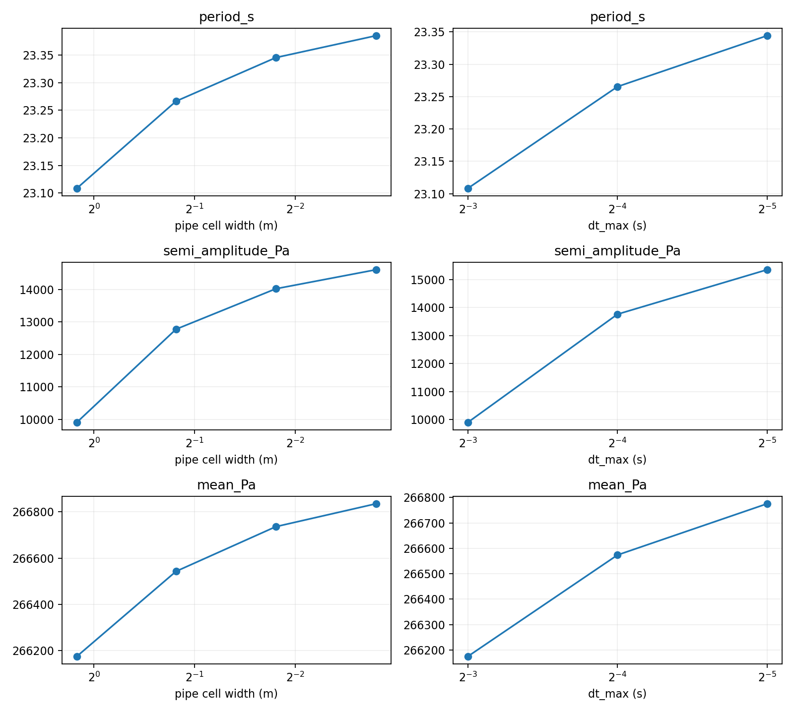
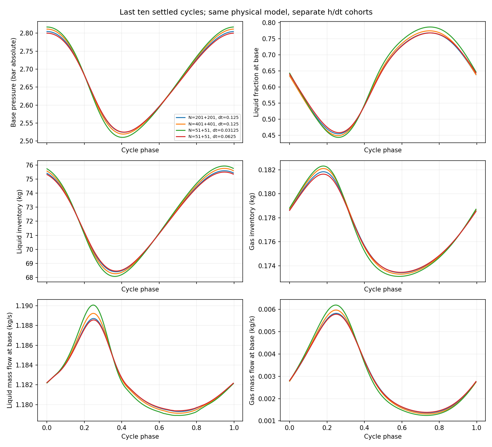
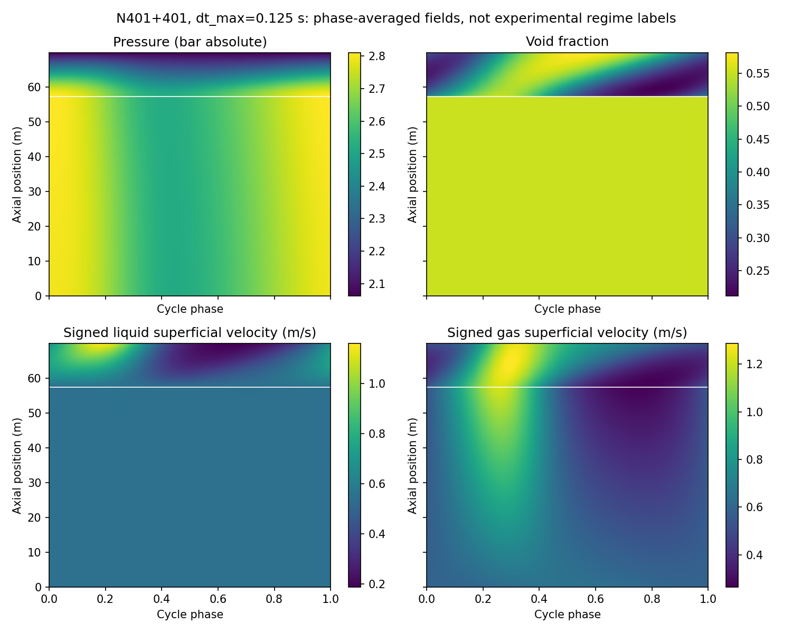
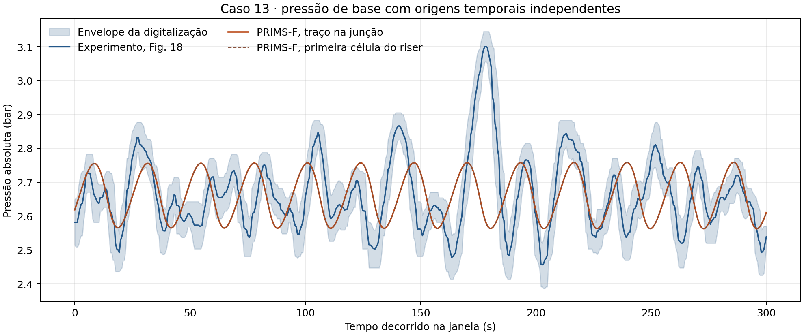

# Qualificação P0/P1 — 19/11/2026

Foram implementadas correções de contrato de alimentação, partição homogênea,
operadores optativos de contorno com fontes e redução exatamente monofásica.
**SS1 e SS3 permanecem BLOCKED; nenhum regime está validado experimentalmente.**
O domínio continua distribuído e conservativo, com uma única malha oleoduto–riser.

## Base, versões e decisão

- Worktree: `/home/leonardoab/Documentos/PRIMS-F-p0p1-20261119`, branch `audit/p0p1-20261119`.
- Main local original `4572f95` e auditoria `6019277` preservados. Main remoto
  reconciliado por fetch: `00df4c2`, incorporação da PR3; seus fontes de produção
  coincidem com `2c3e3af`. Cinco commits exclusivamente de auditoria foram
  reaplicados sobre essa base, sem reset, merge ou alteração da main local.
- `16a4ca7`: partição homogênea; `1365094`: contratos/EOS/IC;
  `18aa7f7`: contorno com fontes, redução monofásica, Jacobianos e telemetria;
  `994736f`: composição externa explícita no refluxo reduzido;
  `71a0693`: inventário inicial explícito propagado por toda a ODE;
  `1603419`: guarda explícita das transições misto–puro e estados não finitos.
- O operador final é `1603419`; os commits de ferramentas/evidência não mudam
  seus fontes de produção. A adição opcional de inventário mantém AUTO legado,
  verificado novamente nas20 suítes e na CLI com comparação byte a byte.
  Cada campanha conserva seu SHA: não atribuímos os dados de `18aa7f7` ao
  operador posterior. A comparação bifásica curta entre os dois operadores
  reproduz todas as colunas do monitor, decimal por decimal: 844 registros no
  controle e 767 em OSC, antes de 119,5 s. A repetição final1603419 de OSC/MASS até2400 s também produziu monitor
  byte a byte idêntico a18aa7f7. Os vinte controles hidrostáticos e
  quatro testes acústicos foram repetidos especificamente em `994736f`.
- `STEADY_TRACE` e `REDUCED/HYDROSTATIC` são optativos; defaults e referências
  legadas foram preservados. MUSCL/SDIRK2 permanecem apenas em diagnósticos.
  A MR deve permanecer draft. A autorização de publicá-la não autoriza merge.

## Matriz requisito → causa → correção → teste → decisão

| Requisito | Causa/evidência demonstrada | Implementação e teste | Estado |
|---|---|---|---|
| P0.1 EOS | Densidade ideal padrão e `p/c_fixed²` diferem; representam hipóteses distintas | `module_feed_contracts`: `c²=RT` em ISOTHERMAL; BAROTROPIC explicitamente `c_fixed²`; derivadas, escalas, CLI e regressão | **PASS** de implementação; BAROTROPIC não qualifica termodinâmica ideal |
| Alimentação/IC | Conversão por densidade de referência não é volume local constante | Bases MASS/LOCAL_VOLUME e LEGACY/STD/SEPARATOR resolvidas e registradas; overrides conflitantes recusados; ODE estacionária recalculada até o fluxo de face convergir | **PASS** no domínio testado |
| P0.2 centro/face | Estado no centro não corresponde à pressão na posição da face em presença de fontes | `STEADY_TRACE` integra a mesma ODE com gravidade, atrito e inclinação; teste estacionário não nulo e Jacobiano completo | **PASS** local; não é well-balanced bifásico global |
| Hidrostática | FV1/POINT não cancela pressão e gravidade | `module_single_phase`: reconstrução hidrostática pela média FV e geometria, fonte de pressão consistente; 5 malhas × 4 gravidades | **PASS**, domínio globalmente monofásico declarado |
| P0.3 partição | MATCHED era aplicado numa divisão entre operadores idênticos | Bypass da projeção; IDs/ângulos e todos os parâmetros físicos globais coincidem; testes de três posições da divisão e conservação | **PASS**, partição homogênea |
| Junção real SS1 | Cancelamento convectivo/dissipativo leva o traço gasoso ao limite do fechamento | Replays, propostas e SI registrados; face real mantém MATCHED e fluxo único por fase | **BLOCKED**, sem correção segura demonstrada para atravessar o limite |
| SS3 | Propostas saem do ramo cocorrente admissível na célula 69 | Status analítico separado de falha de busca; replays/raio Newton preservados | **BLOCKED**, não é prova de inexistência física global |
| P0.4 fase ausente | Jacobiano bifásico não define evolução exata em inventário nulo | Redução para duas equações/duas ondas físicas; fase inativa fica exatamente zero; injeção/transição recusa com status | **PASS** da redução; transição misto–puro **BLOCKED** |
| Refluxo | Inventário no tubo não determina composição externa | `outlet_reservoir_phase=0/1/2`; sem dado externo, refluxo reduzido retorna934; composição diferente retorna932 | **PASS** de contrato/status; reservatório bifásico não modelado |
| Conservação e imposição | Balanço com fluxo efetivo não demonstra alimentação imposta | Ledger aceito independente de `boundary_conditions.csv`; seis balanços, resíduos de alvo e pressão efetiva | **PASS** nos passos aceitos, inclusive controles de 2400 s |
| P1 ondas | Dissipação espacial e temporal afeta amplitude | Testes acústicos reais + ondas características isoladas, Roe/Rusanov, FV1/MUSCL e BE/SDIRK2 | **PASS** de verificação limitada; promoção não autorizada |
| P1 OSC | Acomodação não demonstra convergência de discretização | Campanha nova, sete combinações h/dt e extensões por critério fixo | Ver seção de convergência |
| Física experimental | Amplitude/espectro e mecanismos não coincidem apenas por proximidade de período | Sobreposição Fig.18, campos, inventários, fluxos e análise de eventos | **NOT_VERIFIED** para classificação; amplitude/espectro discrepantes |

## Equações, fontes e domínio

Contrato físico: entrada `jl=Ql0/A` ou fluxo mássico explicitamente selecionado;
gás `rho_g*jg=mdot_g0/A`; topo com `p=Pt` absoluto e saídas calculadas; base do
riser é face interna, sem reaplicar alimentação. As Eqs.24–29, §4/p.5 de
`sistema_oleoduto_riser.pdf`, e Eqs.4.28–4.30 da dissertação, §4.3.1,
fundamentam esses dados. A localização conferida da dissertação é página PDF98,
impressa96; não se adotou silenciosamente a indicação impressa98.
O modelo distribuído PRIMS-F é distinto do sistema reduzido das fontes.

[Baliño, Burr e Nemoto2010](https://doi.org/10.1016/j.ijmultiphaseflow.2010.04.003):
Eqs.78–79/p.649 para conversões; Tabela3/p.653 usa pressão **bar a**.
Não se soma outra atmosfera a Ps=206/208 kPa. Os períodos experimentais são
85,6 s (SS1/caso2), 76 s (SS3/caso11), 19,3–33,8 s (OSC/caso13).
A dissertação informa26 s para SS3: essa discrepância não foi resolvida por
escolha/calibração de período; para a Tabela3 adota-se76 s, sem calcular erro
experimental para uma trajetória SS3 truncada. Sigma é um parâmetro herdado,
com a lacuna de rastreabilidade previamente registrada em benchmark_sources.

EOS usadas: líquido `p=p_l0+c_l²(rho_l-rho_l0)`; gás ideal isotérmico
`p=rho_g RT`, `dp/drho_g=RT`, ou barotrópico declarado `p=c_fixed² rho_g`.
Em `Pstd=101300 Pa`, `Tstd=293,15 K`, `R=287 J/(kg K)`, resultam
`rho_std=1,20403094823 kg/m³`, contra `0,86103579291 kg/m³` para343 m/s.
O coeficiente isotérmico é `sqrt(RT)`, sem gamma adiabático. A conversão de
volume padrão para massa conserva a referência termodinâmica declarada;
BAROTROPIC não é apresentado como gás ideal à mesma temperatura.
`SEPARATOR` é a conversão legada por densidade de referência, não imposição
de vazão de saída. `LOCAL_VOLUME` avalia a densidade na face de entrada;
`MASS` exige override explícito. A inicialização local-volume resolve novamente
a ODE até compatibilidade do fluxo de face; não apenas reescala a IC antiga.

[Baudin–Coquel–Tran2005](https://doi.org/10.1137/030601624), §2.7, Eqs.2.34–2.37
(preprintp.9), distingue dados físicos e projeção local das ondas.
[Munkejord2006](https://www.pvv.org/~stm/dring/cbccomm.pdf), §5/Eqs.11–23,
inclui fontes na formulação característica. São modelos de relaxação com cinco
e de duas velocidades com quatro equações, respectivamente; não transplantamos
suas condições ou controles para as três equações PRIMS-F. `R(U)^-1 U` não é
usado como invariante global. `STEADY_TRACE` é extrapolação estacionária local,
não NSCBC nem solução exata de Riemann bifásica.

Para a redução barotrópica, derivação própria: `h=c² ln rho`, `h+gz=const`.
Partindo da média FV, a densidade de face é
`rho_face=rho_avg*exp[-g(z_face-z_mid)/c²]/<exp[-g(z-z_mid)/c²]>`.
A média usa quadratura Gauss8 da **geometria**; a fonte é a diferença das
pressões reconstruídas dividida pela largura da célula. Nenhuma pressão
analítica do benchmark entra na atualização. A pressão do topo só fixa a IC
hidrostática e a condição física de fronteira.
[Käppeli–Mishra2014](https://doi.org/10.1016/j.jcp.2013.11.028),
[preprint](https://www.sam.math.ethz.ch/sam_reports/reports_final/reports2013/2013-05_rev1.pdf),
Eq.2.7/§2.2 e Eqs.2.13–2.16, sustenta o princípio de reconstrução/fonte
compatíveis; nossa especialização tem duas equações, sem equação de energia.
[Abbasi et al.2021](https://doi.org/10.1002/fld.4921), Eqs.7b,12 e §3.2.2,
trata Euler isotérmico/DFM com atrito laminar. Não se importou sua lei laminar
para substituir o Fanning existente; o traço reutiliza a ODE PRIMS-F.

Chexal1992 mantém seu domínio: contrafluxo vertical, gás ascendente/líquido
descendente; horizontal cocorrente; multiplicidade exige informação adicional.
A catenária não é vertical. Nenhuma guarda de contrafluxo inclinado foi retirada.
Bhagwat permanece opção de regressão. `AUTO_BURR15` continua exclusivamente
diagnóstico; a inconsistência rho_l/rho_g das Eqs.15/54 não foi usada para comutar.

## Mapa fonte → operador → regressão

| Equação/contrato | Rotina/arquivo | Teste reproduzível e evidência |
|---|---|---|
| p=rho RT, dp/drho=RT; contratos mássico/volumétrico | `module_feed_contracts`, `main`, `module_boundary_conditions` | `test_feed_contracts.f90`, `test_feed_contract_cli.py`; EOS_CAMPAIGN/CONTROL_METRICS/OSC_FEED_AB |
| dp/ds com gravidade/atrito e condição na face | `module_boundary_trace::steady_boundary_trace`, `fun_dpds` | `test_source_boundary.f90`; P0_EVIDENCE e curva de incremento FD |
| h+gz=const, média FV | `module_single_phase`, geometria de faces em `main` | `test_single_phase.f90`;20 controles hidrostáticos e REDUCED_WAVES |
| Fase declarada na ODE, dp/ds reduzido | `module_steady_state`, `EstadoEstacionario`, `state_at` | `test_initial_inventory.f90`, CLI; PURE_CLI_71a0693 |
| Uma face interna com um fluxo por fase | `module_simulate_pipe_riser::face_pair` | `test_partition_invariance.f90`, `test_burr15.f90`; falha antiga e partição nova |
| Pesos BE aceitos, residual de imposição separado | atualização temporal/`conservation.csv`/`boundary_conditions.csv` | `test_accepted_telemetry_cli.py`, `test_boundary_telemetry_cli.py`, auditor independente |
| Domínio puro e composição externa explícitos | `module_single_phase`, `initial_phase`, `outlet_reservoir_phase` | `test_single_phase.f90`, `test_initial_inventory_cli.py`; guards932/934/935 |

## Resultados P0 e replays

O teste antigo de partição falha no binário congelado da auditoria anterior;
o teste novo compara N_pipe=0/2/4 em seis volumes com operador idêntico,
resíduos iguais até1e-12, telescopagem e um fluxo por fase. O teste de junção
com fechamentos distintos continua verificando pressão, fluxos e salto de holdup.
Não se impõe continuidade de alfa. Os demais materiais/área são parâmetros
globais únicos: não basta comparar IDs se futuramente forem introduzidos
parâmetros por trecho; nesse caso a equivalência terá de ser ampliada.

Perfil não nulo em malha9+9, integrado por Dormand–Prince e comparado com
o traço RK4: ambos usam a mesma fun_dpds. É uma verificação independente
do integrador e da posição de face, não de uma segunda formulação física: erro na pressão da face de
entrada cai de `2,00834e-3` para `1,19904e-14` adimensional; erro de fluxo
por fase na saída, de `2,05031e-5` para `1,37123e-14`.
O erro do Jacobiano global na direção independente dos dois contornos é
`3,54e-9`. A curva de incremento da derivada de fronteira cai de
`4,28e-3 → 4,19e-5 → 4,17e-7 → 6,09e-9`; não se relaxou a tolerância.
Stencils unilaterais de segunda ordem são usados quando só um lado é
admissível; ausência de stencil retorna erro. O residual é sempre recomputado
com o estado de face/fechamento correspondente. LAGGED usa a mesma matriz
congelada na função e derivada; isso é deliberado, não omissão silenciosa.

Hidrostática `994736f`:20 execuções, N=8/16/32/64/201 **por trecho**,
G=0/4,905/9,81/19,62 m/s², mesma catenária, 1 s e109 passos por execução,
sem rejeições. Velocidade líquida máxima `4,78e-12 m/s`; gás exatamente zero.
O resíduo é avaliado contra o arredondamento condicionado de `rho*c_l²`,
não contra um piso de pressão. A implementação FV1/POINT bifásica padrão
não foi transformada em um método globalmente well-balanced.

Ondas acústicas reduzidas,40/80 volumes: erro de chegada diminui de16,69 para
8,34 microssegundos no líquido e86,19 para43,09 microssegundos no gás.
A reflexão de pressão tem o sinal esperado para pressão fixa; não há alegação
de saída perfeitamente não refletora. Picos incidentes de38,1/50,2 Pa para
perturbação inicial100 Pa expõem a dissipação FV1/BE. A equação modificada
linear fornece `nu=(|c|dx+c²dt)/2` e amplitude gaussiana aproximada
`a*sigma/sqrt(sigma²+2nu*t)`, compatível com esse amortecimento, sem ajuste
de propriedades. Os quatro casos conservam as fases; máximo erro/M0 `7,31e-13`.

| Trajetória `18aa7f7`, pedido110 s | Alcançado | Primeira restrição final registrada | Decisão |
|---|---:|---|---|
| SS1/LEGACY | 78,576784 s | FACE53,3012; lambda7,629e-6; globalização6000 | **BLOCKED** |
| SS1/STEADY_TRACE | 51,199420 s | MAX_NEWTON6100; proposta admissível, lambda0,0625, norma2,57e-8 | **BLOCKED**, variante antecipa falha |
| SS3/LEGACY | 97,131852 s | CELL69,1017; lambda7,629e-6 | **BLOCKED** |
| SS3/STEADY_TRACE | 97,099914 s | CELL73,1017; lambda7,629e-6 | **BLOCKED** |

SS1: no replay do último estado, parcela gasosa convectiva `+0,05577759635`
e dissipativa `-0,05577759635 kg/(m² s)` deixam fluxo da ordem de1e-13,
enquanto as velocidades gasosas adjacentes são positivas. As propostas
examinadas saem do domínio do traço MATCHED; isso não é massa celular
negativa nem contrafluxo físico observado. Jacobianos locais em células
admissíveis concordam com FD na ordem1e-11; esse teste local não prova
consistência de todas as derivadas na fronteira do domínio da face53.
Rusanov nos mesmos snapshots também é recusado na preparação, status1012;
não há fundamento nesses replays para promovê-lo como correção do MATCHED.

SS3:1017 é1000 + (10 + PRIMITIVE_NO_PHYSICAL_ROOT=7), para o ramo
cocorrente e as propostas examinadas. É diferente de1014, falha de busca
sem prova de inexistência, e de6000, falha de globalização. A certificação
anterior de alta precisão permanece associada ao snapshot anterior; não se
amplia sua conclusão para todo o problema físico. Aceitar contrafluxo inclinado
exigiria fechamento primário aplicável à catenária e seleção de ramo; não foi
inventado esse fechamento.

Campanha EOS `1365094`,2400 s pedidos, dt efetivo máximo0,125 s:
BAROTROPIC/MASS completa19222 passos, sem rejeições. ISOTHERMAL/MASS
para em223,644523 s; ISOTHERMAL/LOCAL_VOLUME líquido em223,641971 s,
ambos MAX_NEWTON. No replay com Cg isotérmico correto, o limite reaparece
na face53: passos Newton grandes são recusados, e propostas amortecidas
admissíveis não atingem a tolerância. Isso não demonstra defeito da EOS ideal.
Os balanços aceitos passam nas três trajetórias. Os pilotos anteriores com
dt_max efetivo0,2 s foram identificados como protocolo inválido e preservados.

## Conservação e imposição efetiva

O replay adicional de gás puro pela CLI expôs uma falha de inicialização:
`state_at` não recebia a declaração de inventário e buscava um ramo bifásico
(status21), embora o operador reduzido pudesse evoluir aquele estado.
`71a0693` acrescenta `initial_phase='AUTO'/'LIQUID'/'GAS'` e propaga a opção
por `EstadoEstacionario`, todas as avaliações da ODE e suas perturbações.
AUTO permanece como antes; fluxo nulo não é interpretado como fase ausente.
Inventário puro incompatível com uma alimentação não nula da outra fase é
recusado. O teste independente compara a ODE com
`dp/ds=[-rho*g*sin(theta)-32*mu*u/D²]/[1-u²/c²]` em SI, no regime laminar,
para as duas fases e os dois sinais de velocidade. A escolha de inventário
não fornece automaticamente a composição do reservatório de saída. Em1603419,
uma regressão falha antes e passa depois ao recusar a avaliação reduzida com
inventário aceito misto. A guarda vale nos dois sentidos, com status932 e
estágio PHASE_TRANSITION, sem trocar o modelo durante Newton. Estados não
finitos retornam935 com traps ativos. Não foi observada nem alegada perda de
fase nas campanhas; a mudança fecha explicitamente um domínio não qualificado.


`conservation.csv` integra os fluxos do residual aceito, com os pesos BE de
cada passo; registra resíduos não lineares como defeitos medidos, sem corrigir
balanços. `boundary_conditions.csv` registra os alvos e fluxos efetivos em
todos os passos aceitos, estado de face, pressão EOS e pressão extraída do
mesmo fluxo de momento subtraindo sua própria parcela cinética. Não se usa
média de pressões. Há checkpoint atômico do último U aceito e snapshots de
propostas recusadas. Checkpoint não é um restart geral de ramos Chexal.

Em controle/OSC de2400 s, os resíduos de imposição mássica, absolutos e
integrados, são zero; pressão de topo difere no máximo `5,83e-11 Pa` em OSC.
Contagem observada2/1, sem autovalores nulos/complexos nos estados registrados;
não é regra universal. O operador de traço recusa dados insuficientes132 e
espectro inválido133. O legado não está certificado para toda configuração
supersônica/reversa. O modelo reduzido tem apenas duas ondas físicas; a
diagonal unitária da fase inativa é uma restrição algébrica, não terceira onda.

Máximos dos seis erros normalizados por inventário inicial:
controle `2,37705e-7`, OSC `6,01832e-10`; ambos abaixo1e-6.
Os fluxos integrados de junção cancelam globalmente. Os JSONs informam também
erros em kg e normalizados pela massa processada, sem substituir o critério M0.
Inventário inicial nulo mantém normalização indefinida e erro absoluto;
não se introduz denominador artificial. O estudo anterior tol_res1e-8/1e-10
continua identificado por sua versão: não foi reatribuído a este operador.


Estudo novo `994736f`, mesmo binário, malha51+51,2400 s, dt_max0,125 s,
**somente tol_res varia**, mantendo tol_inc1e-10:

| Erro máximo/M0 | tol_res1e-8 | tol_res1e-10 |
|---|---:|---:|
| Líquido/sistema | 6,19107e-6 | 9,520e-9 |
| Líquido/oleoduto | 5,1383e-8 | 2,500e-11 |
| Líquido/riser | 2,23935e-5 | 3,4707e-8 |
| Gás/sistema | 2,23322e-6 | 2,0695e-8 |
| Gás/oleoduto | 4,50482e-6 | 6,336e-9 |
| Gás/riser | 1,04071e-4 | 2,37705e-7 |

Ambos completam19222 passos sem rejeições. CPU238,77/249,49 s; soluções
lineares2677/4323. O caso1e-8 é **FAIL** no critério de inventário, apesar
do término temporal. Os resíduos de massa aceitos explicam os defeitos
acumulados, verificados pelo auditor independente; não se alterou o limite.

Comparação EOS no controle, mantendo massas prescritas e tol_res=tol_inc1e-10:
ISOTHERMAL completa2400 s,19222 passos, sem rejeições, máximo/M0 `1,97072e-7`.
Separadamente, mantendo o volume líquido local exato e a mesma massa gasosa,
os controles BAROTROPIC e ISOTHERMAL também completam2400 s, ambos sem
rejeições: máximos/M0 `2,51571e-7` e `1,82063e-7`.

Essa última comparação é necessária: no MASS legado, o volume nominal do
controle é `0,00128782384837 m³/s`, mas a vazão local difere até0,01766%
(BAROTROPIC) ou0,01779% (ISOTHERMAL). Os desvios integrados são
`-5,45669e-4` e `-5,49730e-4 m³` em2400 s. Não são o erro do balanço de
massa. Em LOCAL_VOLUME, desvios instantâneos e integrados do volume são
zero no registro. Portanto, MASS é **PASS** para a massa declarada e não
satisfaz estritamente Ql0 constante; para esse contrato físico seleciona-se
LOCAL_VOLUME explicitamente. Não se converteu o modo legado silenciosamente.

Comparação adicional no operador final1603419, BAROTROPIC,2400 s, mesma
malha/passo: MASS e LOCAL_VOLUME completam19222 passos, sem rejeições.
Nas dez últimas oscilações da janela, T é23,103014/23,101886 s, semi-amplitude
9696,075/9687,854 Pa e pressão média266157,954/266158,586 Pa.
As diferenças são−0,004883% em período e−0,084787% em amplitude; os seis
balanços têm máximo/M0 de6,01832e-10 e6,06702e-10. A amplitude ainda varia
2,23%/2,25% entre ciclos: esta comparação mede sensibilidade na mesma janela,
não um ciclo limite acomodado nem validação experimental. O efeito observado
do contrato não explica sozinho a discrepância de amplitude. A inicialização
foi recalculada para cada base, sem reaproveitar a IC incompatível.

## P1: ondas, convergência e custo

No estado bifásico do protótipo linear, ondas físicas `-36,5521`, `0,860603`,
`37,3650 m/s`. Em128 volumes, ganho de uma onda material após um período:
Roe0,82477, Rusanov0,001245. Os ganhos acústicos são próximos de0,82.
Isto quantifica difusão do operador linearizado; não demonstra que ela seja
a única causa da amplitude OSC ou dos bloqueios SS1/SS3.

MUSCL/MC e SSPRK2 reduzem erro L1 da onda suave em64/128/256 volumes:
`0,0063865 / 0,0017231 / 0,00043913`, ordem final aproximada1,97.
FV1, com o mesmo integrador, dá `0,168888 / 0,090968 / 0,047241`.
BE e SDIRK2 são comparados separadamente contra a solução semidiscreta FV1;
ordens verificadas próximas de1 e2. Os traços passam na recuperação real de
primitivas, e limitar inclinações conserva a média. São ondas características
isoladas; estabilidade, positividade geral e Jacobianos do esquema não linear
de segunda ordem permanecem **NOT_VERIFIED**. Nenhuma promoção no solver.

Campanha nova congelada em18aa7f7: BAROTROPIC, Roe/MATCHED, FV1/BE,
tol_res=tol_inc1e-10, mesmos fluidos, EOS, contornos, inicialização e geometria.
Uma única condição FV102, reconstruída dos campos1365094 em2400 s, foi
projetada conservativamente por sobreposição em todas as malhas: defeitos
integrais≤1e-12 adimensionais. É um novo problema inicial comum, com relógio
τ; não uma continuação bit a bit nem2400 s recalculados em cada malha.
Np=Nr=N:51/101/201/401 **por trecho**, portanto102/202/402/802 volumes físicos;
larguras uniformes separadas57,4/N no oleoduto e12,5462539932/N no riser.
A catenária e a inclinação local permanecem idênticas; não se move a junção.

Critérios fixados antes da análise: onze marcadores distintos delimitam dez
ciclos completos; variação (máximo−mínimo)/média≤0,5% de T, semi-amplitude e
pressão média. Horizonte inicial600 s e extensão300 s se necessário.
Alvo de discretização1% para período **e** amplitude, e seis balanços/M0≤1e-6.
Todos os sete casos passaram na acomodação; isso não equivale ao alvo1%.

| N por trecho | dt_max(s) | duração τ(s) | T(s) | semi-amplitude(Pa) | média(Pa) | passos aceitos | dt médio(s) |
|---:|---:|---:|---:|---:|---:|---:|---:|
| 51 | 0.125 | 600 | 23.108397 | 9905.700 | 266174.608 | 4822 | 0.124429697 |
| 101 | 0.125 | 900 | 23.266358 | 12772.067 | 266542.446 | 7244 | 0.124240751 |
| 201 | 0.125 | 900 | 23.345494 | 14018.055 | 266735.998 | 7244 | 0.124240751 |
| 401 | 0.125 | 900 | 23.385285 | 14605.016 | 266835.189 | 7266 | 0.123864575 |
| 51 | 0.0625 | 900 | 23.265434 | 13766.379 | 266573.838 | 14436 | 0.062344140 |
| 51 | 0.03125 | 900 | 23.344152 | 15354.925 | 266775.632 | 28830 | 0.031217482 |
| 101 | 0.0625 | 900 | 23.422672 | 16002.419 | 266957.215 | 14418 | 0.062421973 |

dt mínimo efetivo0,001 s; máximo efetivo igual ao dt_max de cada linha;
as somas dos incrementos recuperam a duração até2,4e-10 s. Não houve rejeições
registradas nas trajetórias selecionadas. A contagem foi auditada incluindo
o primeiro passo de **cada** continuação: steps.csv começa em1, não0.

O período varia0,170155% deN201 paraN401, e0,337206% entre os dois menores
passos. A amplitude varia **4,018901%** espacialmente e **10,345517%**
temporalmente: **FAIL** para convergência ao alvo1%. Pressão média varia
0,037173%/0,075642%, respectivamente. O caso cruzadoN101/dt0,0625 fornece
T23,422672 s e A16002,419 Pa; confirma que o outro eixo ainda influencia
a comparação. Não se alega controle temporal suficientemente resolvido
na série espacial nem controle espacial resolvido na temporal.

Nas três malhas mais finas, ordens formais T≈1,003 e A≈1,097;
nos três passos, T≈0,996 e A≈1,281. Extrapolações formais de amplitude
15122,8/16465,5 Pa sugerem erro restante3,42%/6,75% nos respectivos eixos,
**condicionados à hipótese de um termo dominante**, sem região assintótica
multidimensional demonstrada e sem GCI certificado. Dissipação FV1/BE foi
quantificada nos controles de ondas, mas não foi provada como causa exclusiva
da diferença de amplitude; equilíbrio bifásico global também permanece aberto.



Os quatorze observáveis têm formas de onda médias e dispersão por fase,
RMS com fase fixa e defasagem ótima **diagnóstica**; não se oculta o erro
de fase alinhando os sinais. N201→N401: RMS espacial da pressão365,26 Pa,
alfa0,003531, jl0,006341 m/s, jg0,012393 m/s. No último refinamento temporal:
980,98 Pa,0,009420,0,016717 m/s e0,030848 m/s. Arquivos por fase contêm
pressão, alfa, ul/ug e jl/jg assinados. A interpolação permanece separada
em cada trecho; não atravessa o salto de fechamento na junção.




Frentes: cruzamentos geométricos de alfa0,4/0,5/0,6, com rotina testada;
índice registra todos os candidatos e padding temporal de até2 s usado apenas
na interpolação. Não foi rastreada uma interface material inequívoca nem
provada a sequência física completa de slugging. Campos com espaçamento
máximo1,125 s não resolvem frentes acústicas; não se estima sua velocidade
com esses dados. Classificação local e regime global continuam separados.

Histórias compostas são conjuntos de **análise**, sem run_status de solver
inventado. Três tentativas tiveram TIMEOUT externo e foram retomadas do U
exato do checkpoint; caudas brutas posteriores permanecem preservadas e
seu custo não foi apagado. ContinuaçãoN201 e caso cruzado preservam o próximo
dt exportado. Reinícios originaisN401 emτ270,432 e600 s usam0,001 s e estão
fora da janela dos dez ciclos finais. A/B N201 do controlador muda A0,00761%;
não se atribui uma execução truncada a falha física ou qualificação de regime.

Todos os sete casos passam na aritmética independente do ledger e no
cancelamento da junção. Maior erro integral/M0 entre as42 combinações
fase/trecho/configuração: **9,44192e-9**. Maior defeito por ciclo:3,33885e-11 kg.
JSON inclui kg absolutos, normalizações por M0 e massa processada, e todos os
balanços por ciclo com os mesmos fluxos/pesos BE aceitos. Não há compensação
de estado para fechar massas.

O índice de entrega cobre77 execuções e pelo menos7.357 CPU-h,
 das quais6.144 CPU-h nas tentativas de refinamento/continuação listadas.

São somas de CPU registradas, não tempo de parede somado em tarefas paralelas;
TIMEOUT dá limite inferior de trabalho. Drivers, fontes/objetos, bibliotecas,
binários, ICs/decks e saídas têm hashes. Custos de builds e ferramentas fora
desse índice não estão incluídos. Dados integrais e NPZs ficam fora do Git;
o resumo compacto e hashes estão em REFINEMENT_EVIDENCE/DELIVERY_RUN_INDEX.


## Comparação física e limites restantes

Em2400 s, a janela2100–2400 s fornece excursão da pressão da junção
`0,195962 bar`, abaixo da banda digitalizada `0,536313–0,759777 bar` da
Fig.18/caso13. O pico calculado é0,043315 Hz, contra bins experimentais
0,026618/0,053235 Hz, estes compatíveis com fundamental/harmônico.
A resolução espectral da janela e a digitalização impedem tratá-los como
frequências exatas. A Tabela3 não fornece uma única verdade de período OSC.
A própria janela numérica de2400 s ainda cresce em amplitude; usa-se a
campanha estendida para avaliar acomodação, não essa janela para declará-la.



Os campos espaço-tempo e indicadores de inventários/produção foram gerados.
Cruzamentos de níveis de alfa são frentes geométricas testadas, sem
continuidade artificial de holdup na junção. Compressão, penetração e
blowdown continuam interpretações que exigem evidências combinadas; a
sequência de eventos particular usada no pós-processamento não é requisito
universal de OSC/SS3. Fluxo gasoso positivo na base não invalida esses regimes.
Não há dez ciclos SS1/SS3 nem validação de seus períodos experimentais.

## Reprodução, testes e evidência

GNU Fortran13.3.0, Fortran2018, release `-O2`, debug com bounds/traps,
LAPACK/BLAS3.12.0. **20/20 programas Fortran e110 testes Python PASS**;
21 verificações CLI,11/13 execuções EOS/feed debug/release,5 verificações de
ledger e5 de contorno/checkpoint em cada build aprovadas; mais5 casos de
inventário inicial em cada build. Os dois puros completam1 s pelo programa
principal em `71a0693`, com os seis balanços auditados. CI remota é
separada dessas execuções locais e das campanhas longas.

```sh
make -j2 FC=gfortran LIBS='-llapack -lblas'
make check_all FC=gfortran LIBS='-llapack -lblas'
make test FC=gfortran LIBS='-llapack -lblas'
PYTHONPATH=scripts python3 -m unittest discover -s tests -p 'test_*.py' -v
python3 tests/test_boundary_telemetry_cli.py --binary bin/prims_f_check_all --output tmp/bc_novo
python3 tests/test_feed_contract_cli.py --binary bin/prims_f --output tmp/feed_novo
```

[Ferramentas, protocolos, comandos de drivers e manifestos](../validation/diagnostics/p0p1_20261119/README.md).
Dados completos: `/home/leonardoab/Documentos/PRIMS-F-p0p1-results-20261119`,
em diretórios novos por versão; SHA256 de fontes/binários/decks/saídas,
passos efetivos, rejeições, CPU e motivo de parada são preservados. PDFs e
executáveis não integram o Git. Não houve ajuste físico para forçar slugging,
clipping de massas, piso silencioso ou substituição de espectro.

Próximas correções exigem: uma junção/fluxo admissível fundamentado para
atravessar o limite observado; fechamento inclinado compatível com reversão
se exigido pelo estado; tratamento conservativo misto–puro; e qualificação
do esquema não linear de maior ordem antes de estudar sua promoção.

## Decisão de entrega

| Item final | Estado e limite |
|---|---|
| Contratos EOS/alimentação, IC e regressão legada | **PASS**, hipóteses explícitas; BAROTROPIC não é gás ideal à temperatura experimental |
| Hidrostática/ondas e evolução pura declarada | **PASS** no modelo reduzido e domínios testados |
| Invariância de partição homogênea | **PASS**, junção física permanece distinta |
| Contorno bifásico global com fontes/reversão/supersônico | **NOT_VERIFIED**; traço estacionário optativo não é NSCBC global |
| Transição conservativa misto–puro e reservatório sem composição | **BLOCKED**, status explícitos, sem inventar dados |
| Controle estável2400 s e seis balanços tol_res1e-10 | **PASS**; tol_res1e-8 **FAIL** no mesmo critério |
| SS1 / SS3 | **BLOCKED** nos primeiros limites reproduzidos; nenhum desbloqueio sustentado ou dez ciclos |
| OSC: dez ciclos acomodados e balanços | **PASS** na campanha numérica declarada |
| OSC: alvo1% período/amplitude | Período **PASS** nas diferenças finais; amplitude **FAIL** nos dois eixos; convergência conjunta não demonstrada |
| Captura experimental de SS1/SS3/OSC | **NOT_VERIFIED**, amplitude/espectro e sequência física ainda não qualificados |
| MUSCL/SDIRK2 não linear | **NOT_VERIFIED**, protótipos isolados sem promoção |

Conclusão sobre contornos: há defeitos demonstrados e corrigidos nos controles
delimitados; a qualificação global permanece incompleta. A evidência não permite
atribuir SS1, SS3 ou OSC exclusivamente aos contornos, nem substituir a limitação
constitutiva pela falha da globalização. A MR é draft, sem merge, para revisão
das correções P0 e das evidências; não promove os protótipos P1 nem declara
severe slugging validado.
