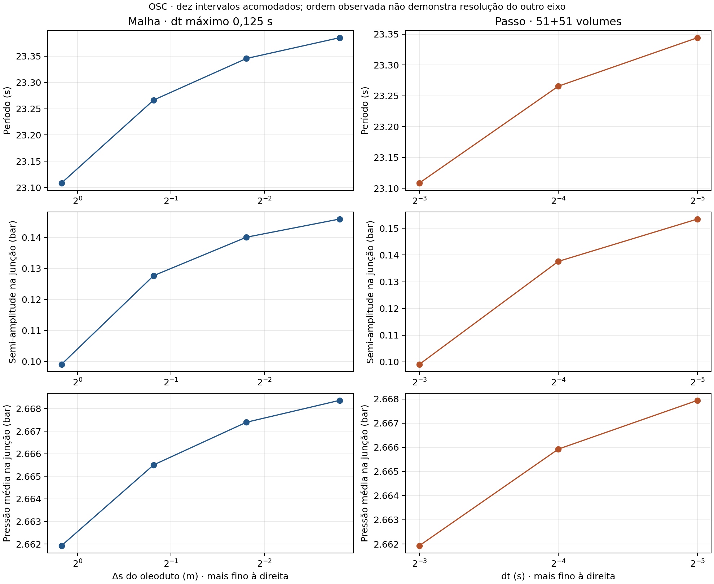

# OSC: refinamentos independentes, 19/11/2026

Esta pasta registra seis integrações de 3600 s com o operador congelado **`69813ee70551fa4a3f075919aeafc45de9693f11`**, fechamento C3/Bhagwat, oleoduto `FIXED_STRATIFIED`, EOS `BAROTROPIC`, junção `MATCHED`, dissipação `LAGGED`, fluxo `ROE` e `tol_res=tol_inc=1e-8`. As cinco novas execuções e a referência nominal usam o mesmo binário SHA256 `7442291fd6cdc311627e79500dc5a4804813b42c7bf4daecf88b4b8b2322288a`.

O [relatório](RESULTS_v2.md) apresenta os valores e limites; o [índice terminal](terminal_index.json) contém os seis balanços globais, os balanços por ciclo, os passos efetivos, os custos e os hashes dos artefatos externos. Todos os casos terminaram sem rejeições, com dez intervalos acomodados nos treze canais, contrato aritmético P2 aprovado e balanços físicos aprovados. Isso não demonstra convergência: a semiamplitude ainda muda 4,013% entre N201 e N401, e 10,318% entre os dois menores tetos temporais. O outro eixo não foi demonstrado resolvido. A pressão marcadora fica na junção fixa; os holdups legados de base/saída usam centros de célula móveis com a malha.

| Execução | Deck efetivo | Manifesto terminal |
|---|---|---|
| Referência N51, dt 0,125 s | [D_OSC.nml](decks/D_OSC.nml) | [D_OSC.json](manifests/D_OSC.json) |
| N101, dt 0,125 s | [N101](decks/D_OSC_h_N101_dt0p125.nml) | [N101](manifests/D_OSC_h_N101_dt0p125.json) |
| N201, dt 0,125 s | [N201](decks/D_OSC_h_N201_dt0p125.nml) | [N201](manifests/D_OSC_h_N201_dt0p125.json) |
| N401, dt 0,125 s | [N401](decks/D_OSC_h_N401_dt0p125.nml) | [N401](manifests/D_OSC_h_N401_dt0p125.json) |
| N51, dt 0,0625 s | [dt 0,0625](decks/D_OSC_dt_N51_dt0p0625.nml) | [dt 0,0625](manifests/D_OSC_dt_N51_dt0p0625.json) |
| N51, dt 0,03125 s | [dt 0,03125](decks/D_OSC_dt_N51_dt0p03125.nml) | [dt 0,03125](manifests/D_OSC_dt_N51_dt0p03125.json) |

Os arquivos copiados preservam seus bytes e caminhos originais. O [mapa do pacote](package.json) associa cada cópia ao caminho externo e ao SHA256 conferido; os JSON originais não foram reescritos para fingir que os dados brutos estão no Git. A pasta externa principal é `/home/leonardoab/Documentos/PRIMS-F-qualification2-results-20261119`; a referência nominal permanece em `/home/leonardoab/Documentos/PRIMS-F-numerics-results-20261119/v1_osc3600`. CSVs, logs extensos, executáveis e PDFs não fazem parte deste pacote.

Metadados locais: [build](provenance/build.json), [plano dos cinco refinamentos](provenance/refinement_plan.json), [selo dos refinamentos](provenance/refinement_seal.json), [plano nominal](provenance/reference_plan.json), [selo nominal](provenance/reference_seal.json), [proveniência da figura](figure_index.json) e [entrega original](delivery.json). Os comandos efetivamente executados constam dos manifestos; o build registra compilador, flags, comandos e bibliotecas. Os decks mantêm os diretórios relativos originais: qualquer reprodução deve usar outro diretório de saída e registrar essa mudança, sem sobrescrever os resultados selados.

A figura usa as duas triplas espaciais e a tripla temporal elegíveis, com hashes dos três JSON de entrada em `figure_index.json`. Ordens observadas positivas não são estimativas GCI nem prova assintótica. A cadência real de observação e os 256 pontos interpolados de fase permanecem identificados separadamente no índice externo.

Os utilitários genéricos foram integrados no commit `9c8a1c8621840d2f1cca077308afda5cb9d3cfd1`, com [instruções de reprodução](../../../scripts/OSC_REFINEMENT_ANALYSIS.md), 17 testes executados e equivalência exata dos observáveis do traço nominal. A campanha usou as cópias externas seladas, cujos hashes permanecem no índice. `RESULTS_v2.md` apenas distingue os critérios efetivamente reprovados de métricas ausentes; a primeira versão externa continua preservada.

Nenhum resultado desta pasta usa a globalização `ACTIVE_SET`, altera o operador congelado ou constitui validação experimental. N51/dt 0,0625 passou o balanço gás/riser com erro relativo ao inventário `9,70359e-7`, próximo do limite `1e-6`. As cotas aritméticas nunca foram adicionadas à tolerância física.
