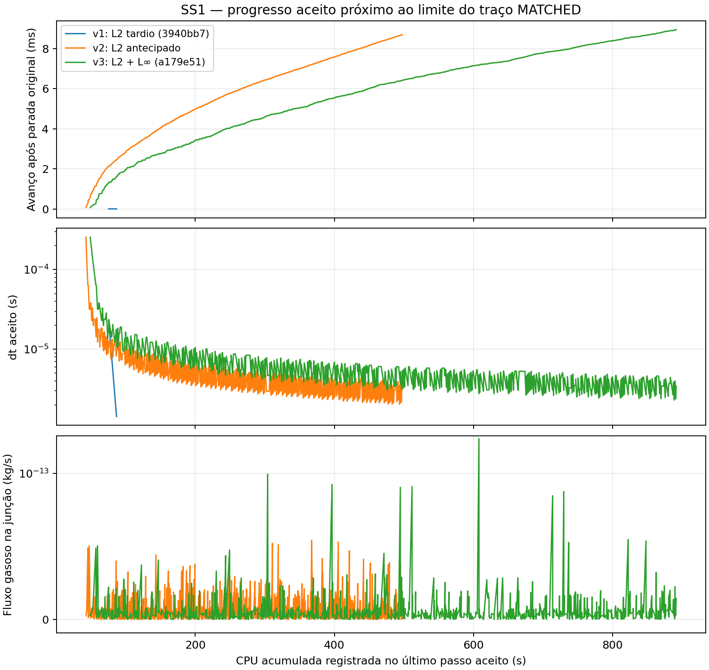

# Smokes ACTIVE_SET v3: qualificação permanece incompleta

Os dois casos usaram o build fresco de
`a179e51d9d63e8aeed91a94d829b5b483d107864`, executável SHA256
`02ce51462ec3c954cec9364b17444b7279be72ec150f87e307f1b5fc8dd0a4c3`.
As entradas originais69813ee foram preservadas, mudando apenas tempo
solicitado, pasta de saída e a opção explícita `ACTIVE_SET`. O helper
verificou os24 hashes de fontes e o HEAD contra o manifesto do build.
Não houve recompilação ou alteração física durante os ensaios. O teto
externo de900s wall foi fixado antes de executar cada smoke.

| Caso | Pedido | Resultado observado | CPU / wall do processo |
|---|---:|---|---:|
| SS1 |100s|TIMEOUT externo; último ledger aceito em78.5807499562s|897.749s /900.003s|
| SS3 |110s|status6000/NEWTON_GLOBALIZATION_FAILURE em97.1318527417s|44.712s /44.968s|

SS1 não tem `run_status.txt` terminal. Os buffers ficaram em posições
diferentes: `steps.csv` contém2082 passos até78.5807294238s,
dt=`3.41024063761e-6s`,239 rejeições registradas e norma=`7.98656e-9`;
`conservation.csv` contém2088 passos até78.5807499562s,
dt=`3.53573749307e-6s` e norma=`8.18226e-9`. São limites inferiores
do progresso observado, não contagens no instante do kill. O snapshot de
rejeição remanescente corresponde a uma rejeição anterior, não ao estado
do TIMEOUT. Cada manifesto identifica separadamente esses papéis.

O último ledger SS1 avançou aproximadamente8.96148ms além da parada do
operador69813ee. CPU quase igual ao wall mostra que a progressão lenta
persistiu com uma CPU efetiva disponível. Isso não é uma falha física
terminal demonstrada, mas também não qualifica a trajetória solicitada.
Nenhuma tolerância foi relaxada para sair da fronteira. A figura local
`SS1_progress.png` compara tempo físico aceito, dt e fluxo gasoso da
junção versus CPU para v1/v2/v3; os dados e a figura estão no ZIP.
Fluxo comum quase nulo não foi convertido automaticamente em inventário
de gás ausente nem usado para habilitar outro fechamento.

O SS3 parou após812 passos aceitos e24 rejeições. O sidecar registra
Newton11, lambda2^-17, proposta1017/CELL69. O replay do novo snapshot
reproduziu o resíduo bit a bit; Newton/L2/L∞ e o avaliador independente
de80 dígitos são detalhados em [../v3_ss3/README.md](../v3_ss3/README.md).
Propostas Newton examinadas têm exclusão cocorrente com folga; as
alternativas ativas ficam marginais e não atingem a norma original.
Isso não prova inexistência global de soluções.

Os seis balanços finais em kg, na ordem
`[l,g,l_pipe,g_pipe,l_riser,g_riser]`, são:

- SS1, último ledger: `[4.18916578e-5,2.15984094e-7,7.69426440e-5,
  2.32789642e-7,-3.50509862e-5,-1.68055484e-8]`.
- SS3: `[3.02691205e-12,-2.32036612e-14,1.33844935e-10,
  -5.92212390e-12,-1.30853550e-10,5.89894800e-12]`.

Os balanços acumulados não são zero. Eles coincidem com a soma dos
resíduos de massa efetivamente aceitos até erro máximo7.42e-13kg em
SS1 e9.50e-14kg emSS3. As diferenças dos fluxos esquerdo/direito da
junção são exatamente zero para as duas fases; inventários mínimos
permanecem positivos. O crescimento do balanço acumulado SS1 durante
muitos passos pequenos é preservado na evidência, sem ocultá-lo sob o
critério local de tolerância.

Esses resultados qualificam testes numéricos locais e registram seus
limites. Não completam100/110s, não demonstram ciclos acomodados, não
validam experimentalmente SS1/SS3 e não autorizam um fechamento de
contracorrente inclinada ou uma regra de frente de fase ausente.

O controle estável2400s do mesmo freeze foi conduzido separadamente pelo
agente principal: monitor/fields/conservation idênticos ao controle69813ee
de mesma tolerância, sem ativar fallback. Esse resultado é uma regressão
numérica; a evidência do controle tem seu próprio manifesto.

## Critério de conservação aplicado ao intervalo observado

Esta coorte usa`tol_res=1e-8`. Para cada fase/seção toma-se o **máximo
do módulo do balanço bruto em todo o ledger**, dividido separadamente
por inventário inicial M0 e massa absoluta processada nas duas faces.
Ambas as razões devem ser<=1e-6. Não se subtrai o resíduo Newton do erro.
Os intervalos vão de t0 ao último ledger completo; não são ciclos.
M0, massa processada e todas as magnitudes estão no JSON.

D_SS1, janela `0–78.5807499562s`:

| Fase/região | Máx. absoluto (kg) | Máx./M0 | Máx./Mprocessada | Ambos<=1e-6 |
|---|---:|---:|---:|---|
|l_system|4.197305e-05|5.237703e-07|2.276991e-07|PASS|
|l_pipe|7.694264e-05|1.408597e-06|4.272718e-07|FAIL|
|l_riser|3.505099e-05|1.373860e-06|1.901246e-07|FAIL|
|g_system|2.159841e-07|1.205806e-06|4.576636e-06|FAIL|
|g_pipe|2.327896e-07|1.325756e-06|4.171657e-06|FAIL|
|g_riser|1.681280e-08|4.762852e-06|2.905401e-07|FAIL|

D_SS3, janela `0–97.1318527417s`:

| Fase/região | Máx. absoluto (kg) | Máx./M0 | Máx./Mprocessada | Ambos<=1e-6 |
|---|---:|---:|---:|---|
|l_system|3.026912e-12|5.683107e-14|2.400592e-14|PASS|
|l_pipe|1.338734e-10|3.904784e-12|1.138409e-12|PASS|
|l_riser|1.338520e-10|7.053338e-12|1.061423e-12|PASS|
|g_system|2.320366e-14|1.051052e-13|9.133332e-14|PASS|
|g_pipe|4.376002e-11|2.142501e-10|1.628415e-10|PASS|
|g_riser|4.375895e-11|2.649052e-09|1.566337e-10|PASS|

**SS1tol8 falha na qualificação de conservação** em cinco das seis
combinações; não se promove seu avanço de milissegundos a solução
conservativa aprovada. SS3 passa esses critérios no intervalo atingido,
mas termina antes do tempo solicitado. Foi iniciada uma coorte separada
com única alteração`tol_res=1e-10`, mantendo`tol_inc=1e-8`, física,
operador e controle temporal. Seus resultados são independentes.

A figura compara v1/v2/v3 com `tol_res=1e-8`; a sensibilidade `1e-10` está em [../v3_tol10/README.md](../v3_tol10/README.md).
